<!-- Draft bio, shared with the portfolio site. Owen to rewrite in his own words. -->
Hi I'm Owen! I'm from SF, work in NYC, and study business and computer science (AI) at IE University in Madrid.  I build software for trading desks and the workflows around them. This summer I was a financial markets intern at Ripple Prime in New York. Three of the tools I built there are in production.

  
  
  
  
  
  
  
  
  
  
  
  
  

### Projects

<table>
  <tr>
    <td width="50%" valign="top">
      
       <a href="https://github.com/owen-alderson/crypto-terminal"><b>crypto-terminal</b></a>
       A trading dashboard for the terminal, built on Coinbase's live feed. Candles, indicators and price alerts. Published on <a href="https://pypi.org/project/crypto-terminal/">PyPI</a>.
    </td>
    <td width="50%" valign="top">
      
       <a href="https://github.com/owen-alderson/meeting-ledger"><b>meeting-ledger</b></a>
       Tracks who promised what across meetings. Every commitment points back to the transcript line it came from, and a second model checks it before it's trusted.
    </td>
  </tr>
  <tr>
    <td width="50%" valign="top">
      
       <a href="https://github.com/owen-alderson/falsealpha"><b>falsealpha</b></a>
       A C++ engine that searches thousands of formulaic trading signals, then tells you which of its own discoveries are fake. On six years of Binance data it tried 7,376 formulas and passed none. Published on <a href="https://pypi.org/project/falsealpha/">PyPI</a>.
    </td>
    <td width="50%" valign="top">
      
       <a href="https://github.com/owen-alderson/backlinker"><b>backlinker</b></a>
       Type one line and it lands in today's Obsidian note with the right people and companies linked. Ambiguous names are left alone, never guessed.
    </td>
  </tr>
</table>

In progress: [ladderbook](https://github.com/owen-alderson/ladderbook), market making research for Kalshi's hourly crypto strike ladders. Built so far: an order book recorder, options-implied fair values, and a C++ backtester that models queue position. The first study, over 1,377 settled hours, found Kalshi's prices forecast better than an options model.

Also: [outreach-desk](https://github.com/owen-alderson/outreach-desk), where Claude drafts outreach and nothing is sent until a person approves it.

Smaller things: [expense-splitter](https://github.com/owen-alderson/expense-splitter), [workout-tracker](https://github.com/owen-alderson/workout-tracker), [financial-ratio-analyzer](https://github.com/owen-alderson/financial-ratio-analyzer), [pdf-research-summarizer](https://github.com/owen-alderson/pdf-research-summarizer), [waitlist-generator](https://github.com/owen-alderson/waitlist-generator).

